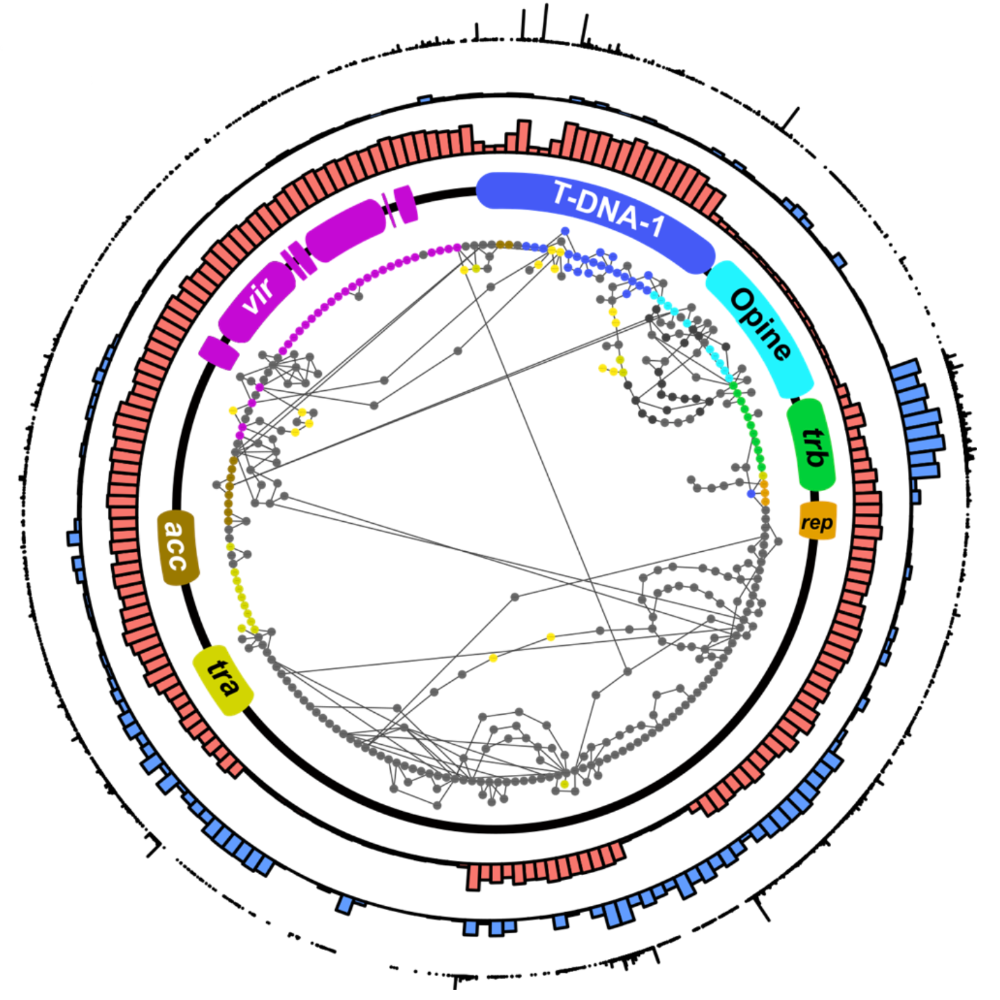

Mobile genetic elements play an important role in many plant/microbe interactions, as well as in human disease, such as antibiotic resistance. MGEs, such as plasmids or integrative conjugative elements (ICEs) can cause bacterial hosts to transition from commensal organisms to pathogens or beneficial mutualists. They are selfish genetic elements that can recombine as well as transmit horizontally between strains, making understanding their evolution and epidemiology difficult. 

Gene synteny network of Type Ib Ti plasmids, showing variation in gene content. Filled circles represent individual genes, while paths linking genes represent the sequence of individual plasmids, which may contain some but not all genes.

Relevant publications
----
Unexpected

Rhodo elife

Rhodo other plasmids

Streptomyces
