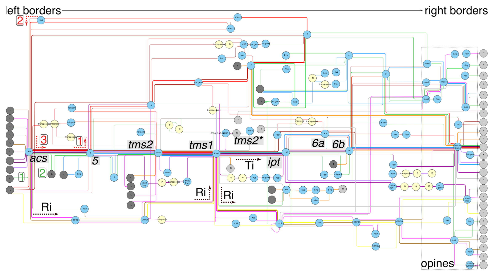

Mobile genetic elements play an important role in many plant/microbe interactions, as well as in human disease, such as those that carry genes conferring antibiotic resistance. MGEs, such as plasmids or integrative conjugative elements (ICEs), can cause bacterial hosts to transition from commensal organisms to pathogens or beneficial mutualists. These selfish genetic elements can recombine as well as transmit horizontally between strains, making understanding their evolution and epidemiology difficult. 

Gene synteny network of Type Ib Ti plasmids, showing variation in gene content. Filled circles represent individual genes, while paths linking genes represent the sequence of individual plasmids, which may contain some but not all genes.

What are the processes that diversify MGEs? How do they exchange loci with other elements and replicons? How do MGEs evolve and change over time?

Variation in gene content of T-DNA regions in agrobacteria Ti and Ri plasmids.

Relevant publications
----
Weisberg, AJ, Davis EW, Tabima J, Belcher MS, Miller M, Kuo CH, Loper JE, Grünwald NJ, Putnam ML, and Chang JH. “Unexpected conservation and global transmission of agrobacterial virulence plasmids.” Science 368, no. 6495 (2020): eaba5256. https://doi.org/10.1126/science.aba5256.

Savory, EW\*, Fuller SL\*, Weisberg AJ\*, Thomas WJ, Gordon MI, Stevens DM, Creason AL, Belcher MS, Serdani M, Wiseman MS, Grünwald NJ, Putnam ML, and Chang JH. “Evolutionary transitions between beneficial and phytopathogenic *Rhodococcus* challenge disease management.” ELife 6 (2017): e30925. https://doi.org/10.7554/elife.30925.

Savory, EA\*, Weisberg AJ\*, Stevens DM, Creason AL, Fuller SL, Pearce EM, and Chang JH. “Phytopathogenic *Rhodococcus* Have diverse plasmids with few conserved virulence functions.” Frontiers in Microbiology 11 (2020): 1022. https://doi.org/10.3389/fmicb.2020.01022.

\*co-first authors

Weisberg, AJ, Kramer CG, Kotha RR, Luthria DL, Chang JH, and Clarke CR. “A novel species-level group of *Streptomyces* exhibits variation in phytopathogenicity despite conservation of virulence loci.” Molecular Plant-Microbe Interactions 34, no. 1 (January 1, 2021): 39–48. https://doi.org/10/gmwnv6.

