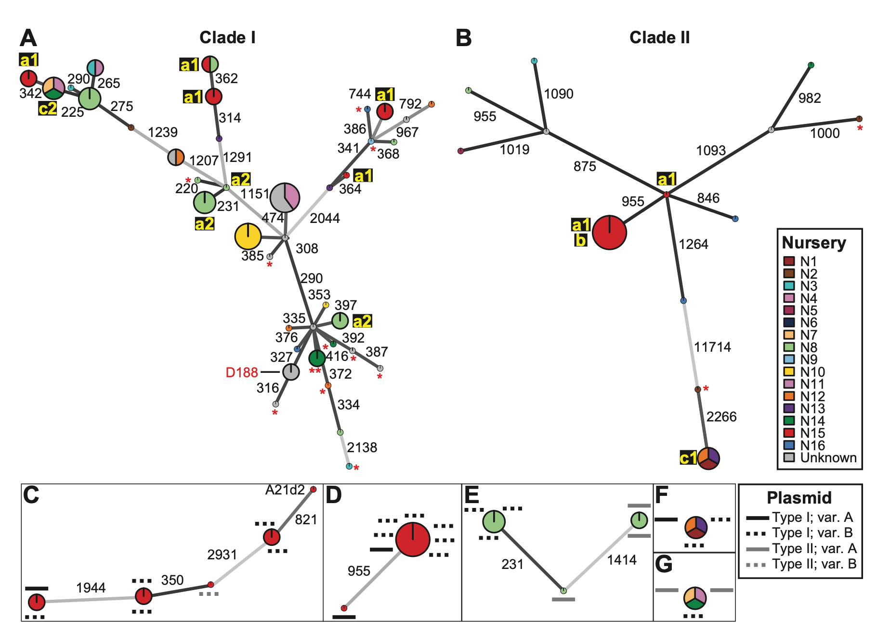
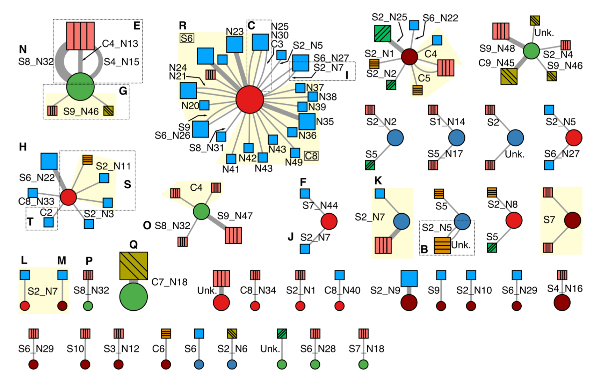

My research investigates the genomic epidemiology of diverse agricultural pathogens, including *Agrobacterium tumefaciens* (crown gall disease), *Rhodococcus fascians* (leafy gall disease), *Streptomyces scabiei* (potato common scab), and *Xanthomonas hortorum* pv. *carotae* (disease of carrot), among others.

Minimum spanning network of phytopathogenic *Rhodococcus*

We developed a pipeline that incorporates a phylogenomic framework for accurate whole genome SNP analysis and comparison that minimizes errors and false-positive SNPs.

This work required developing methods to infer the epidemiology and movement of mobile genetic elements independent of their microbial hosts.

Epidemiological network linking oncogenic plasmid variants (circles) with *Agrobacterium* chromosomal genotypes (squares)

Relevant publications
----

Weisberg AJ, Grünwald NJ, Savory EA, Putnam ML, and Chang JH. “Genomic approaches to plant-pathogen epidemiology and diagnostics.” Annual Review of Phytopathology 59, no. 1 (2021). https://doi.org/10.1146/annurev-phyto-020620-121736.

Weisberg AJ, Davis EW, Tabima J, Belcher MS, Miller M, Kuo CH, Loper JE, Grünwald NJ, Putnam ML, and Chang JH. “Unexpected conservation and global transmission of agrobacterial virulence plasmids.” Science 368, no. 6495 (2020): eaba5256. https://doi.org/10.1126/science.aba5256.

Savory, EA*, Fuller SL*, Weisberg AJ*, Thomas WJ, Gordon MI, Stevens DM, Creason AL, Belcher MS, Serdani M, Wiseman MS, Grünwald NJ, Putnam ML, and Chang JH. “Evolutionary transitions between beneficial and phytopathogenic *Rhodococcus* challenge disease management.” ELife 6 (2017): e30925. https://doi.org/10.7554/elife.30925.
