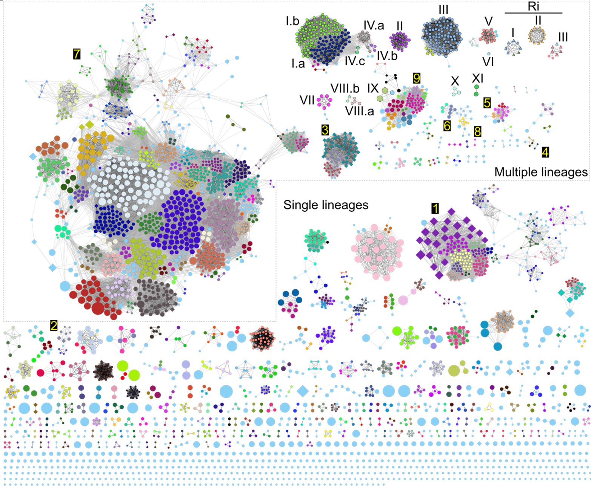

Microbial pathogens (and mutualist symbionts) often have a restricted range of host species on which they can cause disease (or provide beneficial services). Some pathogens have a wide host range, while others are more restricted to one or few host species. The genes conferring this phenotype may be present on the chromosome or on mobile genetic elements, or both. 

Diversity of plasmids in the agrobacteria/rhizobia complex

Mobile genetic elements may also be restricted to specific taxonomic groups or lineages of microbes in which they can persist. What restricts the host range of a MGE? 

Relevant publications
---

Weisberg, AJ, Kramer CG, Kotha RR, Luthria DL, Chang JH, and Clarke CR. “A novel species-level group of *Streptomyces* exhibits variation in phytopathogenicity despite conservation of virulence loci.” Molecular Plant-Microbe Interactions 34, no. 1 (January 1, 2021): 39–48. https://doi.org/10/gmwnv6.

Weisberg A.J., Miller M., Ream W., Grunwald N.J., and Chang J.H. ”Diversification of plasmids in a genus of pathogenic and nitrogen-fixing bacteria” in press. Philosophical Transactions B special issue ”The secret lives of microbial mobile genetic elements.” DOI: 10.1098/rstb.2020.0466
